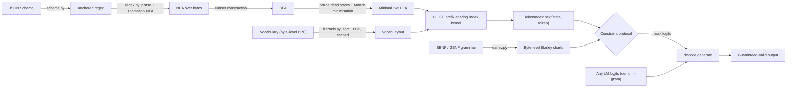

# Syntara — Grammar-Constrained Structured Decoding Engine

[](https://github.com/nagarjunak-pixel/syntara/actions/workflows/ci.yml)
    

**Syntara makes an LLM's output match a JSON Schema, regex or context-free grammar by construction, not by retrying.**
It compiles constraints into a minimal byte-level DFA, then precomputes a token index with a native C++20 prefix-sharing kernel. That index says which vocabulary tokens are legal in each automaton state. For nested languages (JSON, code, DSLs) it runs an incremental byte-level Earley parser. For closed-set "decision" tasks it ranks every candidate by its exact log-likelihood.

It is the same family of techniques behind Outlines, XGrammar, llama.cpp GBNF and provider "structured output" modes, written from scratch with no third-party grammar code. The engine is small enough to read in an afternoon and is tested against Python's `re` and `json` modules as oracles.

```text
                         Syntara benchmark  (Apple M-series, `uv run syntara bench`)
┏━━━━━━━━━━━━━━━━━━━━━━━━━━━━━━━━━━━━━━━━━━━━━━━━━┳━━━━━━━━━━━━━━━┓
┃ Metric                                          ┃         Value ┃
┡━━━━━━━━━━━━━━━━━━━━━━━━━━━━━━━━━━━━━━━━━━━━━━━━━╇━━━━━━━━━━━━━━━┩
│ DFA states / transitions                        │   542 / 23703 │
│ Vocabulary / allowed (state, token) pairs       │   512 / 43077 │
│ Index build native / python (ms)                │  0.23 / 32.06 │
│ Speedup / bit-exact                             │ 141.7x / True │
│ Index build @ 16384 tokens native / python (ms) │ 6.75 / 754.85 │
│ Large-vocab speedup / bit-exact                 │ 111.8x / True │
│ Schema-valid: unconstrained                     │          1/20 │
│ Schema-valid: DFA-constrained                   │         20/20 │
│ Parseable JSON: Earley-constrained (truncated)  │     19/20 (1) │
└─────────────────────────────────────────────────┴───────────────┘
```

The raw report is in [`benchmarks/results.json`](benchmarks/results.json); CI re-runs the benchmark on every push.
Every one of the 20 schema-constrained samples is valid. The one Earley sample that is not
parseable JSON was cut off by the 96-token budget (nested JSON has no length bound), and none
was malformed.

---

## Why this exists

Tool calling, extraction and agent hand-offs all fail the same way: the model emits *almost*
JSON. You can retry, or you can stop that output from being generated at all. Syntara takes the
second route. At each decoding step it sets the logits of illegal tokens to `-inf`. Because the
automaton is **pruned to live states**, a legal token can never lead to a dead end, so the
output stays completable.

The hard part is the **token/terminal mismatch**. BPE tokens such as `",\"role\":\""` cross
several grammar terminals at once. Syntara handles this at byte level, and the demo uses a
real byte-level BPE vocabulary with such multi-byte tokens.

## Architecture



| Module | What it does |
| --- | --- |
| [`regex.py`](src/syntara/regex.py) | Recursive-descent regex parser → Thompson NFA → Rabin–Scott DFA, then pruning of unreachable and dead states and Moore partition-refinement minimisation. UTF-8 literals expand to byte sequences. |
| [`schema.py`](src/syntara/schema.py) | JSON Schema → regex. Covers `type`, `enum`, `const`, `anyOf`/`oneOf`, local `$ref`, `properties`/`required`, `items`/`minItems`/`maxItems`, `minLength`/`maxLength`/`pattern`/`format`. A size-linear construction handles optional properties. Includes a reference validator. **Unsupported assertions raise errors and are never silently ignored.** |
| [`csrc/syntara_kernels.cpp`](csrc/syntara_kernels.cpp) | C++20 `-O3` kernels: the token-index build, masked argmax and mask-density counts. |
| [`kernels.py`](src/syntara/kernels.py) | Builds the kernels with a SHA-256-keyed cache and loads them via `ctypes`. Includes a **bit-identical** pure-Python twin of the same algorithm. |
| [`index.py`](src/syntara/index.py) | `TokenIndex` and `RegexConstraint` (from a regex, a schema or a list of choices). |
| [`earley.py`](src/syntara/earley.py) | GBNF-style EBNF front-end with `( ) \| * + ?`, literals and byte classes. Prunes unproductive and unreachable rules. Incremental, persistent Earley recogniser with Aycock–Horspool nullable handling. `GrammarConstraint` masks tokens via a trie walk. |
| [`tokenizer.py`](src/syntara/tokenizer.py) | Byte-level BPE (deterministic merges) and a tokenizer-agnostic `Vocabulary`. |
| [`decode.py`](src/syntara/decode.py) | Generic `Constraint[S]` protocol, greedy/temperature decoding, and exact closed-set `score_choices`. |
| [`api.py`](src/syntara/api.py) / [`cli.py`](src/syntara/cli.py) | FastAPI service (`/v1/compile`, `/v1/generate`, `/v1/score`) and the `syntara` CLI. |

### The index kernel

A naive index walks every byte of every token from every DFA state: `O(S · Σ|t|)`. Syntara
sorts the vocabulary once and stores, for each token, the length of the prefix it shares with
the previous token (an LCP array). For each state it keeps a stack of DFA states indexed by
depth and resumes each token from that shared prefix. This is an implicit trie DFS. If an
earlier token already died inside the shared prefix, the current token is rejected without
touching any bytes. The Python twin runs the identical algorithm. Hypothesis checks both
against a naive byte-by-byte walk on random vocabularies, including duplicate and empty tokens.

### Earley for context-free constraints

Regular languages cannot balance brackets. `GrammarConstraint` feeds bytes into a persistent
chart, a tuple of columns where each column indexes its items by awaited non-terminal and
pending scans. A prefix is viable exactly when its newest column is non-empty. The grammar has
no unproductive rules, so every viable prefix can be completed. Left recursion
(`expr ::= expr "+" term`) is handled natively.

### Choice scoring vs. greedy constrained decoding

`RegexConstraint.from_choices([...])` guarantees the output is one of the choices, but greedy
decoding commits to the locally best *first token*. `score_choices` scores every candidate in
full, including EOS, so it returns the true maximum-likelihood answer. This matches the
semantics of closed-set "decision" endpoints.

## Quick start

```bash
uv sync --python 3.13 --all-extras

uv run syntara compile                       # demo schema -> regex -> minimal DFA stats
uv run syntara compile --regex '(a|b)*abb'   # 4-state minimal DFA
uv run syntara generate --temperature 0.8    # schema-constrained sample (always valid)
uv run syntara generate --unconstrained      # same LM without masking, for contrast
uv run syntara generate --json-grammar       # Earley-constrained arbitrary JSON
uv run syntara score engineer analyst --prompt "Ravi Ng is a 40 year old "
uv run syntara bench --output benchmarks/results.json
uv run syntara serve --port 8090             # FastAPI on http://127.0.0.1:8090/docs
```

```python
from syntara import RegexConstraint, generate
from syntara.corpus import PERSON_SCHEMA, demo_bundle

bundle = demo_bundle()                      # byte-level BPE (512 tokens) + 4-gram LM
vocab = bundle.tokenizer.vocab
constraint = RegexConstraint.from_schema(PERSON_SCHEMA, vocab)
out = generate(bundle.lm, vocab, constraint, temperature=0.8, seed=1)
print(out.text)   # {"name":"...","age":..,"role":"...","active":true}
```

To use a real LLM, build a `Vocabulary` from its tokenizer's byte strings and apply
`constraint.allowed(state)` to its logits each step. The constraint objects never look at the
model.

## Engineering guarantees

- **Differential testing against oracles.** 20 regex patterns are checked against
  `re.fullmatch` with Hypothesis. The Earley JSON grammar is checked against `json.loads` on
  fuzzed byte strings and on `json.dumps` of generated values. The schema regex is checked
  against the reference validator on 300 seeded records (valid and invalid).
- **Bit-exactness.** The C++ kernel, the Python twin and a naive walk all produce identical
  index matrices.
- **Gates.** `ruff`, `mypy --strict` (src + tests), `pytest` with **≥95% branch coverage**
  (currently 99%+), and C++ compiled with `-Wall -Wextra -Werror` in CI.
- **No mocks.** Every test drives real automata, real BPE vocabularies, real kernels and a
  real (small) language model.

## Scope and honest limits

- Objects are **closed** and properties are emitted **in declaration order**, as in Outlines.
  `additionalProperties: true`, numeric `minimum`/`maximum`, `allOf` and recursive `$ref` raise
  `SchemaError`. Use a grammar for recursive structures.
- `minLength`/`maxLength` count JSON string *units*: one per ASCII character or escape, and one
  per UTF-8 byte for non-ASCII characters.
- The bundled LM is a deterministic 4-gram model, so CI runs in seconds without weights. The
  masking layer does not depend on the model.

## Repository layout

```text
csrc/syntara_kernels.cpp   C++20 token-index / masked-argmax kernels
src/syntara/               regex, schema, earley, tokenizer, index, kernels, decode, lm, api, cli, bench
tests/                     157 tests (Hypothesis property + differential + API/CLI)
benchmarks/results.json    reproducible benchmark output
```

## References

Willard & Louf, *Efficient Guided Generation for LLMs* (2023) · Dong et al., *XGrammar* (2024)
· Earley, *An Efficient Context-Free Parsing Algorithm* (1970) · Aycock & Horspool, *Practical
Earley Parsing* (2002) · Thompson (1968) · Rabin & Scott (1959) · Moore (1956) · Sennrich et al.,
*BPE* (2016).

---

## Author & Canonical Portfolio

Engineered by **Nagarjuna Reddy Kamireddy** (*Lead AI Architect*). Released under the [Apache-2.0 License](LICENSE).
- **Architecture Portfolio & Case Studies:** [https://nagarjunak-pixel.github.io/](https://nagarjunak-pixel.github.io/)
- **GitHub:** [@nagarjunak-pixel](https://github.com/nagarjunak-pixel) · **LinkedIn:** [in/nagarjuna-kamireddy](https://linkedin.com/in/nagarjuna-kamireddy)
